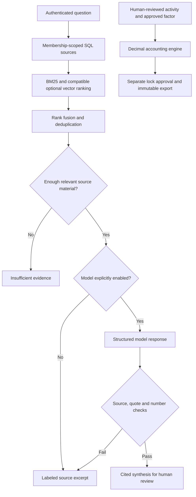

# CarbonOS AI, RAG, and calculation upgrade

Date: 4 November 2026. Delivery branch: `Asif`. Starting commit: `3ba08e7`.

## Decision

The full project needs more work before a production pilot. The strongest architecture keeps approved emissions arithmetic deterministic, then uses AI to extract and explain evidence. The [GHG Protocol calculation guidance](https://ghgprotocol.org/calculation-tools-faq) describes activity data and applicable emission factors as calculation inputs. A model's generated number or confidence score is not a substitute for either input.

Use the existing Decimal ledger for the inventory and use RAG for document-backed questions. ML can later assist document classification, anomaly triage, and forecasting when labeled documents or adequate facility histories exist. Training, fine-tuning, OCR accuracy, regulatory correctness, and enterprise reliability have not been established merely by adding model calls.

## Implemented in this increment

| Area | Change and practical result |
| --- | --- |
| Calculation inputs | Reject nonfinite/negative quantities and factors; block duplicate activity IDs, invalid date windows, and noncanonical memo units. Invalid inputs cannot silently contaminate totals. Existing review, factor-version, boundary, and snapshot controls remain in force. |
| Authoritative retrieval | HTTP queries read membership-scoped SQL document/chunk rows. SQL owns visibility and source content; optional vector files cannot add unauthorized or rolled-back passages to a prompt. |
| Hybrid ranking | BM25 lexical search plus compatible optional vector ranks, combined by reciprocal-rank fusion. English/Bengali tokenization and digit normalization support local search. Hash features are explicitly lexical; they are not learned semantic embeddings. |
| Index compatibility | New stored vectors carry an embedding-space identity. Dense ranking rejects old untagged vectors, mismatched model spaces, stale content, invalid dimensions, and nonfinite vectors. Missing vector files retain SQL lexical search. |
| Generated evidence | Gemini returns structured claims and quotations. Each source ID must belong to the authorized retrieved set; quotes must occur in the cited passage; numbers must occur in quoted evidence. The server constructs citations. Invalid output uses a labeled retrieved excerpt. A model can abstain even when passages were retrieved. |
| Provenance | Responses identify document/passage IDs, passage SHA-256, page, model, answer mode, ranking-score semantics, review requirement, and candidate-limit status. Source status defaults to `UNREVIEWED`; a retrieved reference is not automatically an official or current regulation. |
| Privacy | RAG model answering now requires its own `ESG_LLM_RAG_ENABLED` opt-in. Production requires a processing-terms reference for RAG or extraction. Both model paths put credentials in headers; provider bodies/credential URLs are excluded from new error reporting. No existing credential was printed or committed. |
| Working interface | `/platform/esg` → **Evidence assistant** indexes documents, asks source-backed questions, displays provenance and insufficient-evidence states, and runs the actual extraction regression. The legacy ATLAS screen uses the real endpoint instead of invented scores and a timer. |
| Extraction | Rules require explicit units, recognize common bill/delivery labels and reversed quantity/unit labels, handle Bengali digits, retain source snippets, and omit conflicting values rather than selecting one arbitrarily. Scope 3 field extraction does not implement Scope 3 ledger accounting. CNG remains unsupported by this parser. |
| Honest evaluation | Removed the benchmark's ground-truth substitution, fabricated confidence, and non-F1 metric. Failures stay null/failed. Replaced the unsupported `AUDITED_AND_VERIFIED` RAG report. |
| Legacy estimates | Old scenario calculation/catalogue/regression endpoints are demo-only (404 otherwise), labeled as sample/unreviewed, and cannot grant approval. The wrapper no longer issues an audit hash/seal. Protected accounting uses the real ledger routes. |

No new package was added. No accounting total is generated by an LLM. No customer input was sent in the live checks.

## Current architecture

The model has no execution tools and no permission to approve or mutate the ledger. These controls reduce specific failure modes; they do not solve semantic hallucination or prompt injection. The [OWASP guidance](https://cheatsheetseries.owasp.org/cheatsheets/LLM_Prompt_Injection_Prevention_Cheat_Sheet.html) describes why layered controls and continued evaluation are needed. The provider's [structured-output documentation](https://ai.google.dev/gemini-api/docs/structured-output) establishes schema support, not truthfulness of the resulting content.

## Measured evidence

- [Twelve-query retrieval fixture](rag-retrieval-regression.json): 7 answerable and 5 negative queries across private/shared sources and English/Bengali. Observed recall@5 = 1.0, MRR@5 = 1.0, negative abstention = 1.0. These are small synthetic SQL/BM25 regressions with no stored learned dense vectors, not general search-quality results.
- [Ten-case extraction fixture](extraction-regression.json): the repaired benchmark initially exposed 0/10 exact matches. Improving the shared parser produced 9/10; the unsupported CNG case remains failed. This is synthetic text, not real invoices, OCR, or model extraction accuracy.
- [Five recorded live generation checks](rag-provider-smoke.json): four returned the expected synthesis/abstention mode; the initial supported question fell back to a retrieved excerpt and is retained as a failed synthesis expectation. A separate diagnostic call returned a valid quoted answer. Later supported calls named `gemini-2.5-flash`; unsupported questions abstained. This small sample is not a reliability, latency, or semantic-entailment benchmark.
- Backend/API, JS, browser, and repository verification outcomes are listed below. Provider calls were disabled in automated suites; only synthetic inputs were used in separate live checks.

## Verification

| Check | Result |
| --- | --- |
| TypeScript checking / production build | Passed; existing `zlib` browser externalization warning remains |
| JavaScript regressions | 6 passed |
| ESG tests | 103 run; 102 passed, 1 PostgreSQL-only skip |
| Orchestrator tests | 34 passed |
| Existing direct tenant-isolation tests | 4 passed; new API and SQL-source isolation tests additionally exercise the real paths |
| Protected desktop 1440×900 and phone 320×720 browser suites | 26 passed, 4 intentional isolated-demo-only skips |
| Isolated demo desktop/phone showcase suite | 8 passed: evidence indexing/query/citations/abstention/regression plus accounting extraction/review/calculation/lock/export/reset |
| Repository frontend contract | Failed: missing funnel artifact, unresolved evidence templates, and 70 source-heuristic findings. No gate waiver or suppression added. |

The new rendered flow was checked for source upload, real API answers, escaped plain text, source/provenance expansion, failed-query recovery, synthetic benchmark failures, readable mobile wrapping, and page overflow. Automated Browser-plugin skill availability was absent; the installed repository Playwright runner performed browser regressions, and CUA/IAB provided the separate manual rehearsal. No new browser package was installed.

- [Desktop evidence interface](evidence-assistant-1440.png)
- [Phone evidence interface](evidence-assistant-320.png)
- [Actual live Gemini answer in the app](evidence-assistant-live-ai.png): CUA/IAB uploaded the synthetic policy, indexed it, and submitted the question. The visible answer contained three cited claims, named Gemini 2.5 Flash, and displayed the source's unreviewed status. No relevant console warnings/errors or framework overlay were observed. The temporary viewport override was reset. IAB screenshots can be softer than automated captures.
- [Presenter runbook, including optional model flags](RUNBOOK.md)

## Remaining work, in order

1. **Source governance and real evaluation:** collect consented, independently labeled invoices and questions, split held-out data by issuer/document family, adjudicate annotations, and version the corpus. Review primary regulatory sources for jurisdiction, date, amendments, licensing, and applicability. Existing seed text and static catalogues are not independently verified authorities.
2. **Document AI/OCR:** support the actual pilot's scans, Bengali layouts, tables, units, invoice periods, meters, and duplicates. Measure field exact match, unit/period accuracy, false extraction, abstention, and review effort. Fail closed on unsupported formats; no automatic ledger approval.
3. **Learned retrieval and reranking:** install/pin the chosen embedding model in the deployment, reindex under an explicit model identity, evaluate Bengali/English semantic questions and contradictions, then justify any cross-encoder or query expansion against measured gains. Current tests prove compatibility logic, not learned semantic quality.
4. **Scale and operations:** replace the bounded scan with an authorized lexical index/pgvector candidate pipeline when the corpus grows; benchmark latency, concurrency, and relevance. Current HTTP search examines at most 2,000 recent authorized chunks and exposes when it reaches that bound. The JSON vector cache still lacks concurrent-writer guarantees; losing it degrades to SQL search.
5. **ML for calculation review:** evaluate anomaly detection against facility/meter-specific historical baselines, seasonality, known corrections, and false-positive budgets. Explain every flag and preserve the submitted value. Forecasts/scenarios must remain separate from an approved inventory. No trained anomaly model is claimed here.
6. **Broader project quality:** reconcile remaining legacy dashboard and telemetry claims; validate crop-model training/calibration and field performance; move browser-exposed service credentials server-side; finish PostgreSQL/OIDC/backup/restore/load checks and the failed frontend contract. See the [21-gap project audit](AI_SUMMIT_READINESS.md).
7. **Pilot release gate:** use a protected deployment, validated factors, approved processing terms, real-device testing, independent accounting/security review, and rehearsed operations before calling the full platform production ready.

The next upgrade should be driven by the pilot's actual documents and acceptance thresholds. Larger models or more agents alone cannot establish accuracy or reliability.
