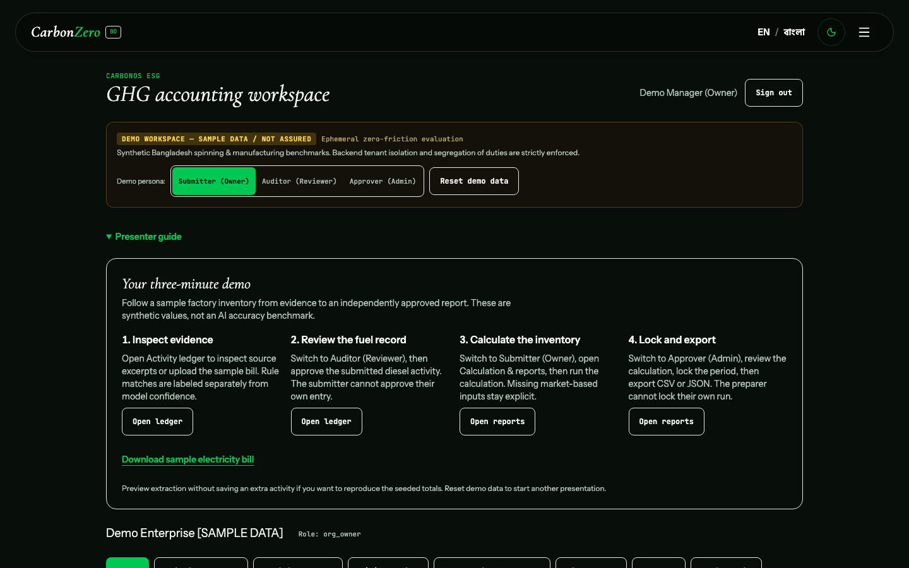

# Summit upgrade: implementation evidence

Date: 3 November 2026. Branch: `Asif`. Starting commit: `f6f8fe8`.

## Delivered first batch

- Repaired canonical demo activity/factor types and diesel units. Removed invented official factor citations; new/reset demo tenants use explicitly synthetic custom factors.
- Added a separate demo approver identity using the existing admin role. The preparer remains unable to lock their own calculation. Record review, lock, and reproducible exports use the actual API.
- Added shared, time-bounded demo bootstrap and response validation, recoverable failure states, protected/OIDC entry, and a reset returning to Setup. Existing demo sessions need reset to gain the new approver.
- Added an in-product presenter guide, downloadable synthetic electricity bill, [three-minute runbook](RUNBOOK.md), [21-gap audit](AI_SUMMIT_READINESS.md), and [implementation prompt](UPGRADE_PROMPT.md).
- Replaced unsupported lead-page trading/payout/registry/official/customer-verification claims with workflow capabilities and explicit sample labels. Updated About's introduction/statistics, metadata, and favicon. Corrected the release-readiness Scope 3 claim. Other specialist-page claims remain in the audit.
- Validated optional model output before returning it as AI extraction: known finite nonnegative quantities, matching details, source-excerpt presence, and confidence bounds. Invalid results fall back to rules. The UI shows the actual method/model and requires human review; a source excerpt alone does not prove numeric or unit correctness.
- Production startup rejects public demo access modes. Production identity, accounting permissions, and tenant boundaries were not relaxed.

## Final local checks

| Check | Observed result |
| --- | --- |
| `npm run lint` | Passed (TypeScript checking) |
| `npm test` | 6 passed, including session concurrency, expiry, malformed response, protected entry, and retry |
| `npm run build` | Passed; existing `zlib` browser externalization warning remains |
| `.venv-esg/bin/python -m unittest discover -s tests -p 'test_esg*.py'` | 87 run: 86 passed, 1 PostgreSQL-only skip |
| Default protected browser suite, desktop 1440×900 + small mobile 320×720 | 26 passed; 2 intentionally skipped isolated-demo-only cases |
| Isolated-demo showcase suite, same two projects | 6 passed |
| `git diff --check` | Passed |
| `.venv-esg/bin/python -m orchestrator.cli frontend-check --area all` | Failed: missing funnel artifact, unresolved measurement/SEO/accessibility/performance templates, 71 source-heuristic findings |

Browser services were started fresh with their test configuration, not reused from the presenter preview. Model access was disabled for automated browser/API suites. Existing accounting tests cover authorization and deterministic reporting; the new showcase test uses the project viewport and real isolated API data.

The real seeded journey uploads the public sample, finds 125,000 kWh, reviews the submitted diesel record, calculates 12.06 t Scope 1 and 80 t location-based Scope 2, rejects preparer self-lock, locks with the separate approver, downloads CSV, and resets to Setup. API coverage additionally verifies byte-identical repeated exports and the not-assured disclaimer.

The earlier [responsive foundation report](../qa/responsive-upgrade-report.md) records eight viewport projects. The changed summit flow was rerun at the two extreme widths above; this is not a claim that all specialist modules or physical devices have been certified.

The design hook's flagged ClientShowcase heading gradient was replaced with solid emerald. No suppression was added. The broader repository frontend contract remains failed; its failures are not waived by this report.

## Actual provider and browser rehearsal

[provider-smoke-check.json](provider-smoke-check.json) records two live synthetic calls through the validated extraction path with the existing server-side Gemini configuration:

| Input | Method/model | Result | Single observed duration |
| --- | --- | --- | --- |
| Supplied synthetic electricity bill | LLM / gemini-2.5-flash | 125,000 kWh; one evidence detail | 4.17 s |
| Synthetic memo with no activity | LLM / gemini-2.5-flash | Zero activity; no evidence details | 3.79 s |

These are two smoke checks, not measured accuracy, a load test, or latency/reliability guarantees. A subsequent upload in the actual in-app browser displayed “AI-assisted extraction (gemini-2.5-flash),” 125,000 kWh, its source excerpt, and model-confidence/review guidance. Choosing **Use** populated an unsaved activity draft; no duplicate activity was saved. Only synthetic input was sent. No credential was created, exposed, committed, or placed in frontend configuration.

IAB also checked the presenter guide and role controls at desktop and 320 px, with no horizontal page overflow, and manually collapsed the guide. The temporary viewport override was reset. IAB captures can be softer than the crisp automated viewport images.

## Screenshots

- [Desktop presenter guide, 1440 px](summit-workspace-1440.png)
- [Narrow-phone presenter guide, 320 px](summit-workspace-320.png)
- [Actual AI extraction and unsaved draft, IAB](summit-ai-extraction.png)

## Remaining release boundaries

The lead ESG demo is substantially more credible; the complete platform is not production ready. Real-document accuracy/OCR, real mobile Safari/Android hardware, PostgreSQL concurrency, deployed OIDC, hosting/restore/security review, device/registry integrations, logo rights, team/contact/pilot facts, booth allocation, and a recorded presentation backup remain unverified or externally dependent. Local retrieval uses the existing fallback when optional ChromaDB/SentenceTransformer dependencies are absent; no hosted RAG-quality claim follows from these tests.

The preview binds only to localhost. The optional AI rehearsal uses process-local development settings and synthetic SQLite data; it is not a deployment. Follow the runbook for a rules-only presentation when model access is unavailable. Confirm actual booth instructions and repeat the walkthrough on the presentation laptop before freezing the showcase build.
